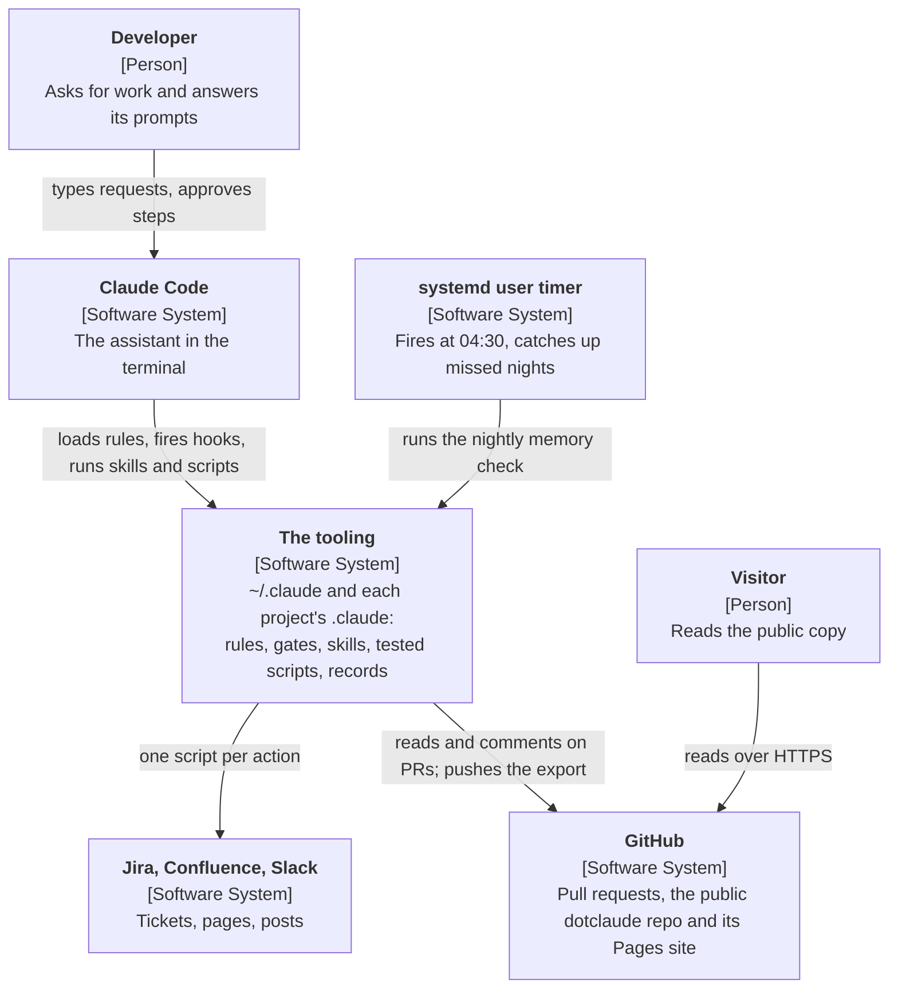
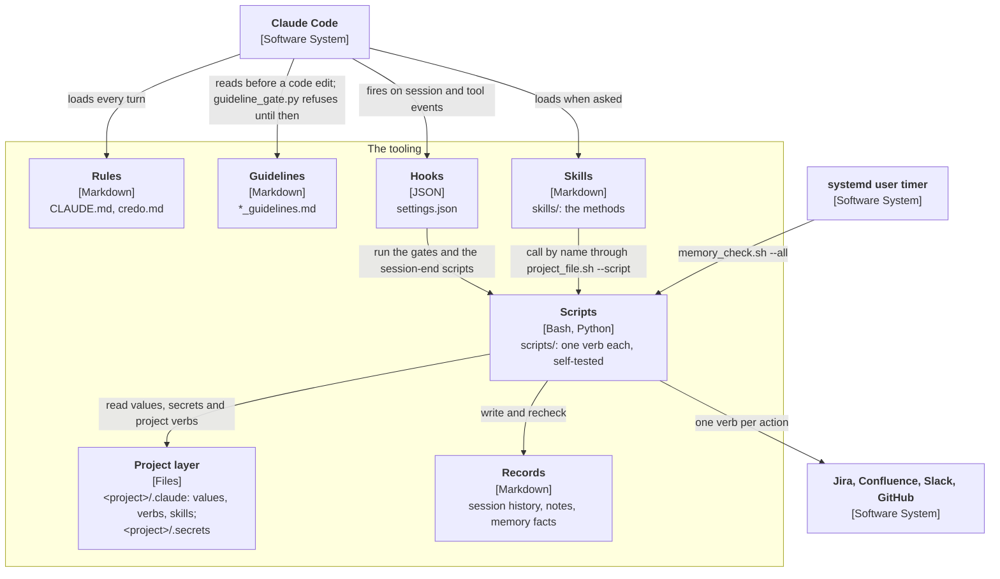
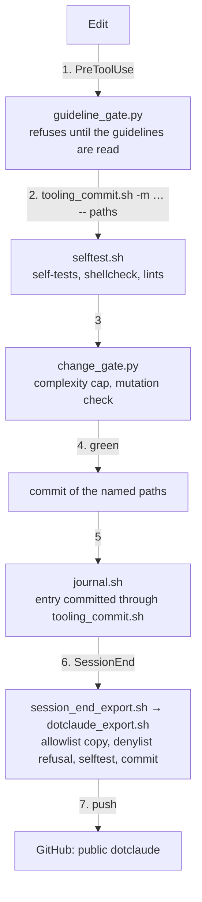
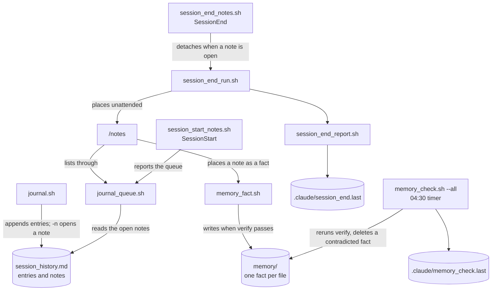

# Architecture

How the tooling is built, why each part exists, and how a part is added,
changed or removed. The list of every item, what it does and who calls it,
is generated on demand: `/inventory` (`scripts/skill_inventory.py`) prints
the census with each script's callers under "named by", and
`scripts/script_find.py <words>` finds a script by what its header says.
This page names entry points only.

## Layers

Two layers, and every session runs in exactly one project.

- **Global**: `~/.claude`. The methods every project can run, the scripts
  they call, the rules and the hooks. It names no employer.
- **Project**: `<project>/.claude`. That project's values, secrets, verbs,
  domain skills and records. Nothing about one project lives anywhere else.

A project is a git repository that `scripts/project_init.sh` has set up. The
project layer is the nearest `.claude/` at or above the working directory;
`~/.claude` is never taken for one. A name resolves in the project first,
then in the global layer, and a name in neither stops the caller with exit 1.
Nothing guesses and nothing falls back to a default.

## Parts

| Part | What it is | Layers |
|---|---|---|
| value | One setting, one file, such as `atlassian_site` | Project only; no global defaults |
| secret | One credential, one file in `<project>/.secrets/`, never versioned | Project only |
| script | One verb: its contract in `--help`, proven by `--self-test` | Both; a project script overrides the global one of the same name and keeps its contract |
| skill | A method: the order of steps, the judgement, the claim each step proves | Global for shared workflows, project for domain work; never overridden |
| rule | A `CLAUDE.md` line, loaded every turn | Both, by Claude Code's own layering |
| setting | Permissions, plugins and hooks in `settings.json` and `<project>/.claude/settings.local.json` | Both; a project's settings are not inherited from parent directories |
| record | Session history, notes and memory facts | Project only |

### Value and secret

`scripts/project_file.sh --value <name>` prints a value without its blank
and `#` lines, and exits 1 naming where it looked when the file is missing or
holds no value. `scripts/secret_file.sh <name>` prints the path of
`<project>/.secrets/<name>`, and exits 1 when it is absent or empty. A script
must read every value and credential through these two, never from a path of
its own.

### Script

A script is one verb. Its header is its contract, `--help` prints it, and
its `--self-test` proves it; `shell_coding_guidelines.md` states the header,
the exit codes and the self-test.

`scripts/project_file.sh --script <name>` resolves a script: the project's
`.claude/scripts/<name>`, else `~/.claude/scripts/<name>`, else exit 1
naming both. A project script that overrides a global one keeps the global
contract. The global script's `--self-test` proves it by running the
implementation `UNDER_TEST` names, and `gate_layer_names` in the project's
`selftest.sh` fails an override whose global script does not read
`UNDER_TEST`, or whose cases it does not pass.

### Skill

A skill holds the method and nothing else: the steps, the judgement, and the
claim each step proves. It must call scripts by name, through
`project_file.sh --script`, and hold no value, ID or URL. It names a
capability, such as the tracker or the chat, where it can.

Claude Code loads a personal skill over a project skill of the same name, so
a skill name lives in one layer only; `gate_layer_names` fails a name both
hold.

### Composition

Skills call scripts, and scripts call scripts, each by name through
`project_file.sh --script`; a sourced library such as `atlassian-auth.sh` is
found the same way, and a Python script resolves through `scripts/resolve.py`.
The two resolvers are reached at `~/.claude/scripts`, and a self-test sources
`tap.sh` or imports `tap.py` from beside itself. A step that differs between projects is a verb the project
provides. Its contract is the claim it proves. For example, `pr_env` takes a
PR reference, prints the environment's URL, and exits 0 only once the PR's
head commit is proven deployed there. How it gets there is the project's
business. `scripts/project_verbs.txt` lists every verb a global part calls,
with its contract, which the project's script carries word for word in its
`--help`; `gate_verb_contracts` fails a copy that differs. A project without the verb stops at that step. When two projects
implement a verb the same way, the implementation moves to the global layer.

### Where prose goes

| Prose | Home |
|---|---|
| A script's caveats | Its `--help` |
| A fact about one project | A memory fact in that project |
| A policy that holds every turn | `CLAUDE.md` |
| The method | The skill |

## Context and containers

The diagrams follow the C4 model (https://c4model.com). The system is both
layers. `/inventory` is the code-level view, generated from the tree.

## The map

Each family below names the problem it solves, its entry points, and what
it hands on.

### Rules and their gates

`CLAUDE.md` and `credo.md`, which it imports, are in every turn's context
and say how every session works. The `*_guidelines.md` files are read on
demand, before a code edit. A rule that can be checked names the script that enforces it,
and hooks in `settings.json` run those scripts:

- `scripts/guideline_gate.py`: no code is edited before its guidelines are read.
- `scripts/ask_gate.py`: a question to the user goes through the question dialog.
- `scripts/block_gate.py`: once a call is blocked, nothing else runs until the user answers.
- `scripts/draft_gate.py`: no text is sent to people before the `draft` skill is loaded (`normative` also opens a Confluence page write). Each writer calls its `check` before it sends, so a script that calls a writer is held too.

### The gate loop

Every change is proven before it is kept. Each script's `--self-test` proves
its contract. `scripts/selftest.sh` runs every self-test, `shellcheck`, and
the lints for frontmatter, settings, allowed tools and prose names, then
`scripts/change_gate.py` holds the changed code to the complexity cap and the
mutation check. `scripts/gate_lib.sh` holds the checks every tooling repo
shares. `scripts/tooling_commit.sh` commits named paths only when that gate
is green; `journal.sh` commits the session history through it.

A change is kept in this order:

### Records: history, notes and memory

What a session did and learned outlives it.

- **History.** `scripts/journal.sh` appends one entry per state-changing turn
  to `<project>/.claude/session_history.md`. `/timelog` bills from it.
- **Notes.** `journal.sh -n` opens a note in the same file;
  `scripts/journal_queue.sh` reads the queue, for `/notes` and `/recap`.
  `/notes` places each note as a
  fact, skill, script, rule, setting or ticket. A SessionStart hook
  (`scripts/session_start_notes.sh`) reports the queue. A SessionEnd hook
  (`scripts/session_end_notes.sh`) places what it can unattended, and
  `scripts/session_end_report.sh` writes `.claude/session_end.last` for the
  next session.
- **Memory.** `scripts/memory_fact.sh` writes a fact only when its `verify`
  command passes. `scripts/memory_check.sh --all` re-runs every command each
  night, on the timer `scripts/memory_schedule.sh` installs, and deletes a
  fact its own command contradicts. `scripts/git_fact.sh` checks a claim
  about a file in a repository. A project's facts live in
  `<project>/.claude-project-data/memory/`, versioned with the project.

### Projects and accounts

- `scripts/project_init.sh` makes a git repository a project: its `.claude/`,
  a private `<project>/.secrets/`, the ignore lines that keep secrets and
  transcripts out of git, and the link from `~/.claude/projects/<slug>` into
  `<project>/.claude-project-data/`, where Claude Code then keeps the
  project's sessions and memory. A second run has nothing to do.
- `scripts/project_file.sh` and `scripts/secret_file.sh` resolve a project's
  values, scripts and secrets; `scripts/resolve.py` reads them for Python.
- `scripts/claude_account.sh` runs a project under the account its
  `.claude/config_dir` names. That account's directory links every shared
  entry back to `~/.claude`, so one copy of the tooling serves every account.
  A SessionStart hook says when a session runs under the wrong one.
- `scripts/dev_setup.sh` reports a clone's branch, its drift and its
  uncommitted work.
- `scripts/git_sweep.sh`, run once a day from a SessionEnd hook
  (`scripts/session_end_sweep.sh`), removes git state that is proven finished
  and writes `.claude/git_sweep.last`.

### Service verbs

One script per action on an outside system. A verb that needs a site or a
token reads it through `project_file.sh` and `secret_file.sh`:

- Jira: `jira-*.sh`
- Confluence: `confluence-*.sh`, with `atlassian-auth.sh`
- GitHub pull requests: `gh-pr-*.sh`, `gh_pr_ref.py`, `gh-ticket-prs.sh`, `ticket_prs.py`
- Slack: `slack_post.py`, `slack_thread.py`
- Browser logins: `playwright_login.sh`

### Workflows

The skills a person asks for by name: `review:pr`, `review:bot`,
`request:review`, `timelog`, `draft`, `voice`, `audit`, `benchmark`,
`normative`, `gist`, `inventory`, `recap`, `journal`, `notes`,
`standup`, `postmortem`, `slack:reply`, `ticket` and `qa`. Most are methods over the verbs above. `skill_triggers.json` holds the cases that say
when each should fire, and `scripts/skill_trigger_test.py` runs them.

### Publishing

`~/.claude` is a local-only repo. For each new commit,
`scripts/session_end_export.sh` runs `scripts/dotclaude_export.sh`, which
copies the allowlisted part into the public dotclaude clone, refuses any name
in `dotclaude_denylist.txt`, runs the copy's selftest and commits; then
`session_end_export.sh` pushes the clone. Text in the global layer is
therefore public, and names no employer.

## Changing the system

### Add a skill

1. **Choose its layer.** A method any project could run goes in
   `~/.claude/skills/`; domain work goes in the project. The name must not
   exist in the other layer.
2. **The skill holds the method only.** It calls scripts by name through
   `project_file.sh --script`, and holds no value, ID or URL.
3. **Every step that touches a system is a script.**
   - Reuse one that fits (`script_find.py`).
   - A new one states its contract in `--help` and proves it with `--self-test`.
   - A step that differs per project is a verb the project provides.
4. **Every setting is a value file in the project, and every credential a secret.**
5. **Caveats go in `--help`, project facts in memory, and every-turn policy in `CLAUDE.md`.**
6. **In the same commit:** add the skill's cases to `skill_triggers.json`,
   get `selftest.sh` green, and update every document the skill makes false.

### Add a script

Search first with `script_find.py`. A new script is one verb, with its
header, its exit codes and its `--self-test`. A verb that holds a project's
specifics lives in that project; one with none lives in the global layer. A
project verb that a global part calls is listed with its contract in
`scripts/project_verbs.txt`, in the same commit as its first caller. A
project verb moves to the global layer when a second project implements it
the same way.

### Add a project

Run `scripts/project_init.sh` in the repository, with `--account <config
dir>` when it runs under its own account. Then add the project's
`scripts/selftest.sh`, sourcing `gate_lib.sh` and running `gate_layer_names`.

### Change a part

A changed contract changes its `--help`, its `--self-test` and every caller
`/inventory <name>` lists under "named by", in one commit.

### Remove a part

`/inventory <name>` shows what names the part. Remove or repoint those
callers first. Delete the part in the same commit as every document that
names it.
